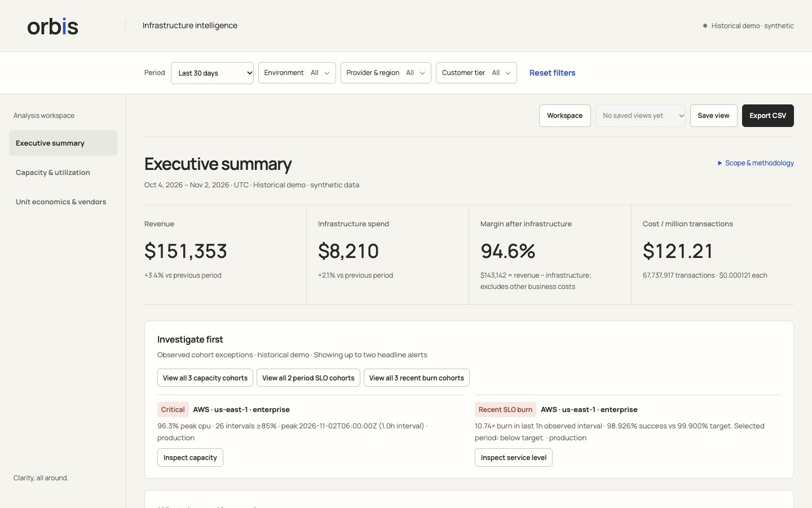
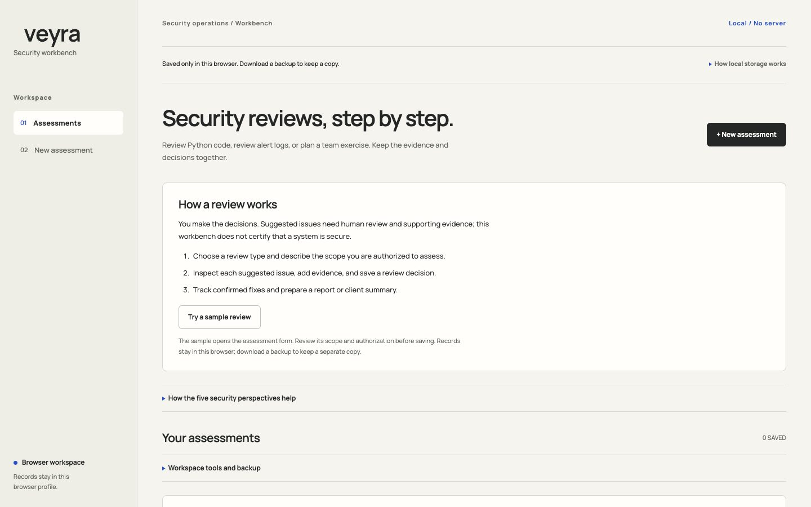

# Hugging Face Spaces

Source snapshots of nine public [Hugging Face Spaces](https://huggingface.co/PabloRod11/spaces). Veyra was refreshed November 15, 2026, and Orbis November 7, 2026; the other seven projects retain their October 31 snapshots.

Each public snapshot contains the original deployed files, documentation, tests, and available assets. Downloadable source ZIPs are preserved and also unpacked under each project’s `source/` directory so their code can be browsed directly on GitHub.

| Project | Source | Live Space |
| --- | --- | --- |
| Orbis | [Browse](projects/orbis/) | [Open](https://huggingface.co/spaces/PabloRod11/ledgerline-business-analyst) |
| Veyra | [Browse](projects/napolean-cyber-command/) | [Open](https://huggingface.co/spaces/PabloRod11/napolean-cyber-command) |
| Imperial ML Laboratory | [Browse](projects/imperial-ml-laboratory/) | [Open](https://huggingface.co/spaces/PabloRod11/imperial-ml-laboratory) |
| Pocket PhD | [Browse](projects/pocket-phd/) | [Open](https://huggingface.co/spaces/PabloRod11/pocket-phd) |
| Intake Desk | [Browse](projects/intake-desk/) | [Open](https://huggingface.co/spaces/PabloRod11/intake-desk) |
| Occupation Review Studio | [Browse](projects/occupation-review-studio/) | [Open](https://huggingface.co/spaces/PabloRod11/occupation-review-studio) |
| ServiceLedger SQL Reconciliation | [Browse](projects/service-ledger-sql-reconciliation/) | [Open](https://huggingface.co/spaces/PabloRod11/service-ledger-sql-reconciliation) |
| Imperial LLM | [Browse](projects/imperial-llm/) | [Open](https://huggingface.co/spaces/PabloRod11/imperial-llm) |
| QuantLab Probability Research | [Browse](projects/quantlab-probability-research/) | [Open](https://huggingface.co/spaces/PabloRod11/quantlab-probability-research) |

## Latest release — November 15, 2026

Veyra adds original HTTP/HTTPS, TLS, DNS and SSH study cards, RFC references, a separate Protocol Explorer link, and optional unsaved workbook prompts under Role tasks. Existing records and backups remain compatible. [Release verification](RELEASE-2026-11-15-veyra-protocol-context.md).

## Previous releases — November 7, 2026

- **[Orbis](projects/orbis/):** infrastructure analytics, capacity planning and vendor unit economics, with explicit synthetic demo data, accessible chart tables and an optional Python companion.
- **[Veyra](projects/napolean-cyber-command/):** the renamed security workbench, with analyst-reviewed evidence, remediation tracking and frozen reports. The source folder and live URL retain their previous names to preserve existing links.
- Both releases include the new wordmarks, self-hosted fonts, source, tests and design documentation. [Release provenance and verification](RELEASE-2026-11-07.md).

### Earlier additions

- **Animated portfolio preview:** [five perspectives → scoped evidence → analyst review → owner and retest](https://pablo-rodriguez-portfolio.sanjusri2002.chatgpt.site/#cyber-command), with local/global pause controls, reduced-motion support and mobile steps. This is an illustrative workflow, not app footage or a live scanner.
- **Imperial LLM Model 005:** the current [model card](https://huggingface.co/spaces/PabloRod11/imperial-llm/blob/main/MODEL_CARD.md) and [release checks](https://huggingface.co/spaces/PabloRod11/imperial-llm/blob/main/RELEASE_CHECKS.json) document browser inference engineering and a failed prose-quality review. The October 31 source snapshot below has not been refreshed by this catalog update.

[Portfolio](https://pablo-rodriguez-portfolio.sanjusri2002.chatgpt.site/#work) · [Explainable ML, demos and human review collection](https://huggingface.co/collections/PabloRod11/explainable-ml-models-demos-and-human-review)

## Projects

### [Orbis](projects/orbis/)

Infrastructure operations and business economics in one browser workspace: executive metrics, capacity and utilization, vendor costs, scenarios, forecasts and investigations. The bundled demo is synthetic. Optional Python companion tools support validated data ingestion and signed update events.

[](https://huggingface.co/spaces/PabloRod11/ledgerline-business-analyst)

### [Veyra](projects/napolean-cyber-command/)

Browser-local security assessment workbench for authorized code review, structured alerts and exercise scenarios. Analysts review nominated findings, record evidence and decisions, track remediation, and prepare reports. It uses bounded heuristics and human review; it does not run an ML model, autonomous agents or live scans. Existing browser records and backup identifiers remain compatible.

[](https://huggingface.co/spaces/PabloRod11/napolean-cyber-command)

### [Imperial ML Laboratory](projects/imperial-ml-laboratory/)

Browser inference demo with a downloadable Python training and evaluation project.

Additional source: [source](projects/imperial-ml-laboratory/source/source/).

### [Pocket PhD](projects/pocket-phd/)

Browser research workspace with evidence tools, local model support, and a Python search companion.

### [Intake Desk](projects/intake-desk/)

Small-business inquiry intake demo.

### [Occupation Review Studio](projects/occupation-review-studio/)

Occupation classification and a simulated human-review queue, with model and evaluation sources.

Additional source: [source-package](projects/occupation-review-studio/source/source-package/).

### [ServiceLedger SQL Reconciliation](projects/service-ledger-sql-reconciliation/)

SQL billing reconciliation, synthetic datasets, and acceptance checks.

Additional source: [sql-reconciliation-case-study](projects/service-ledger-sql-reconciliation/source/sql-reconciliation-case-study/).

### [Imperial LLM](projects/imperial-llm/)

Experimental character-level language model with training sources, checkpoints, and evaluation evidence.

Additional source: [source](projects/imperial-llm/source/source/).

### [QuantLab Probability Research](projects/quantlab-probability-research/)

Browser-local probability research with Python sources and downloadable study packages.

Additional source: [forecast-study](projects/quantlab-probability-research/source/forecast-study/), [leakage-audit](projects/quantlab-probability-research/source/leakage-audit/), [model-study](projects/quantlab-probability-research/source/model-study/), [python-project](projects/quantlab-probability-research/source/python-project/).

## Run a demo locally

All nine public Space snapshots use static HTML, CSS, and JavaScript. From this repository:

```bash
python3 -m http.server 8000
```

Open `http://localhost:8000/projects/<project-name>/`. See each project’s README for model downloads, browser requirements, dependency installation, Python tooling, and tests. Serving over localhost also supports browser features that require a secure context.

## Provenance and scope

- Orbis and Veyra use pinned November 7 public Hugging Face revisions recorded in `source-manifest.json`. The other seven projects retain their October 31 snapshots. Browser records and customer evidence are not copied.
- `source-manifest.json` records every original snapshot file, its pinned Hugging Face revision, byte count, and SHA-256 digest.
- `extracted-source-manifest.json` maps unpacked files to their original archive members and records SHA-256 digests.
- This is a snapshot of the public Spaces, including source archives attached there. Separate Hugging Face model and dataset repositories are outside this snapshot; project documentation retains their links.
- Git history, deployment secrets, Space settings, and hosted runtime state are not copied. Future Hugging Face changes do not automatically sync.
- Original source files and archives are preserved without modification. GitHub-only preview images and the nested Orbis data attributes file are documented in the release notes; they are excluded from the upstream snapshot manifest. Archive contents may describe earlier experiments or releases; the deployed files at the project root remain the pinned Space snapshot.
- Existing licenses and attribution notices are preserved. This collection does not grant a new blanket license over projects or third-party material.
- Migration checks establish file and archive integrity. They do not establish model quality, application correctness, or reproducibility of training results.
