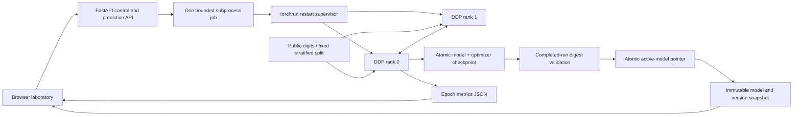

# Architecture and boundaries

The writable laboratory runs on a trusted local host. The public Docker image enables inference while disabling training and promotion.

## Evidence and ownership

Run directories contain status, worker logs, checkpoint and metric history. Rank zero publishes each epoch checkpoint; barriers ensure the group reaches that boundary. A controlled rank-one exit after epoch two triggers a worker-group restart. Both ranks restore the model and Adam state; the sampler uses the fixed epoch seed. An uninterrupted and recovered run yielded exactly equal weights and non-timing learning metrics.

The API permits one local job at a time. Completed artifacts are hashed before promotion; predictions use a model/version snapshot under a lock. Startup restores the persisted pointer and rejects a digest mismatch. Orphaned running jobs are marked failed because the supervisor cannot prove their outcome. There is no claim of scheduler durability, distributed leases, authorization or tenant isolation.

## Limits that matter

- Shared single-host storage and two processes; node failure and remote storage recovery are untested.
- Training pads the 1,078-image partition to complete global batches; global batch size is fixed across worker counts and padding is recorded.
- Fixed batch size per rank changes optimizer steps in the one-versus-two comparison.
- Validation uses 359 images for epoch selection. Final evaluation uses 360 disjoint test images after minimum-validation-loss selection; inference loads selected weights.
- Directory fsync improves checkpoint durability, but does not establish replicated storage or recovery from every crash boundary.
- Public inference needs hosting-provider controls for rate limits and abuse protection.
- Runtime evidence uses trusted artifacts and legacy PyTorch 2.2.2 on Intel macOS. The supported Linux/PyTorch >=2.6 image and remote CI remain unexecuted.
