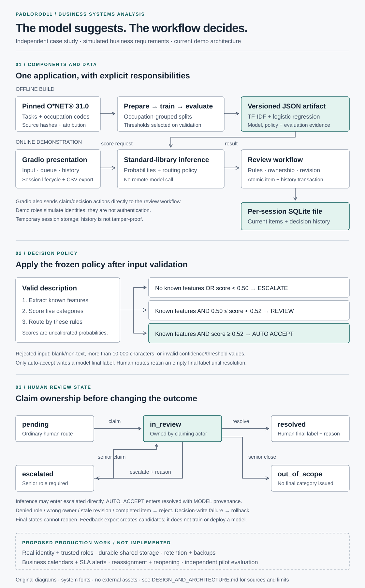

# The model suggests. The workflow decides.

**Independent case study with simulated business requirements.** This document describes the delivered Python/Gradio demonstration. It does not claim stakeholder interviews, business sign-off, authenticated users, durable hosted storage, or an operational SLA.

## Current architecture

`prepare_data.py` downloads pinned O*NET® 31.0 task and occupation CSVs, validates an explicit 55-occupation mapping, removes repeated normalized task text, and assigns whole occupations to train/validation/test. It writes source hashes, mapping and exclusions into provenance. The five project categories are simulated requirements, not official O*NET® categories.

`train.py` fits TF-IDF and logistic regression on training data, selects routing thresholds on validation, evaluates the held-out test set, and exports numeric JSON. `inference.py` loads that artifact and reproduces feature extraction and probability calculations with the Python standard library. Runtime inference does not need a training service or a network model call. Export parity is tested; probabilities remain uncalibrated.

`app.py` owns the Gradio presentation, input/error messages, session lifecycle and CSV download. `review.py` owns routing validation and review transactions. Its rules can be exercised without starting the UI. SQLite is the concrete storage adapter inside that module; this small application does not introduce repository interfaces or microservices. The app creates a separate temporary SQLite file for each session. Each action opens a store for the same file and closes it afterward.

`items` is the authoritative current record. `history` stores snapshots with action, actor, role, UTC time and reason. Creation and decisions commit their record and history together. Revision checks and an immediate SQLite write transaction prevent a stale decision overwriting newer state. History is inspectable and editable by anyone who can alter the database file; it is not an immutable audit service.

## Decision and exception contract

The delivered model artifact sets `auto_accept=0.52` and `escalate=0.50`. Zero known features escalates first, regardless of a numerically high class score. Otherwise confidence below 0.50 escalates, confidence from 0.50 up to but excluding 0.52 enters ordinary review, and confidence at least 0.52 resolves with MODEL provenance. These thresholds differ from the original notebook's 0.80/0.50 example: they were selected using this implementation's validation set, not the final test set. They are frozen release parameters, not a guarantee of correctness or a production operating policy.

Pending and escalated records have no final label. Claiming creates `in_review` and assigns an owner. A claimed record can be resolved with a supported category and reason, or escalated with a reason. Escalation releases ownership and permanently requires a senior role for subsequent actions. Only a senior may close a claimed item as `out_of_scope`, leaving its final label empty. Resolved and out-of-scope records are immutable in this demo. No reopening, reassignment or needs-information state exists.

A blank/non-text/overlong input is rejected before model inference. Invalid confidence, thresholds, labels and model versions fail validation. Audit readers cannot mutate records; ordinary reviewers cannot act on escalations. An unclaimed record or a claim owned by another actor cannot be decided. A stale revision fails and requires refresh; repeated submissions are not an idempotent API. A transaction failure rolls back changes, but the application has no managed retry queue or external incident notification.

The role selector supplies **simulated identities**, not authentication. All ordinary-reviewer choices share a demonstration actor ID, and the same is true of the senior role. Ownership tests demonstrate application rules; they do not establish distinct real-user identities or a security boundary. Use fictional, non-sensitive input only.

## Design choices and references

- **Editorial diagrams.** The [diagram-design README](https://github.com/cathrynlavery/diagram-design) informed the thin rules, restrained accent, generous spacing and explicit accessible SVG title/description. The SVG is original, uses system fonts and makes no external requests. No plugin or remote code was installed. Its three panels show different concerns instead of combining every connection into one drawing.
- **Separate responsibilities and record decisions.** The [CleanArchitecture README](https://github.com/jasontaylordev/CleanArchitecture) describes an ASP.NET application template and documents architecture decisions. This project adopts small presentation, inference and workflow boundaries plus explicit decisions; it does not adopt that template, its .NET dependencies or its framework stack. Storage and workflow remain together until a second adapter or operational requirement justifies separating them.
- **Make tradeoffs explicit.** The [system-design-primer](https://github.com/donnemartin/system-design-primer) surveys consistency, relational storage, caching and asynchronous queues as tradeoffs. The current demo favors one local transaction for state plus history. Replication, caches, a message broker and horizontal workers are deferred because the demonstration has no measured scale requirement.
- **Start with scope and failure paths.** The [system-design-notes README](https://github.com/liquidslr/system-design-notes) lists interview framing, estimation, notification and monitoring topics. Here those prompts become an explicit boundary between the running demo and future operations. The notes are secondary learning material; no capacity estimate or notification implementation is claimed from reading them.
- **Use examples for discovery, not proof.** The [system-design-project topic page](https://github.com/topics/system-design-project) lists varied educational applications, including transactional stores and rate limiters. It prompted checking that our artifact explains its own consistency and exception behavior. A topic listing does not validate this project's architecture; no listed implementation was copied.

The supplied `go-gorm/daisyui` combined repository URL was unavailable during research. We checked the separate official projects instead:

- [GORM](https://github.com/go-gorm/gorm) is a Go ORM with transaction and locking features. The project retains Python's SQLite API and explicit transaction tests; installing a Go persistence stack would add no required behavior here.
- [daisyUI](https://github.com/saadeghi/daisyui) is a Tailwind CSS component library. The visual review borrowed semantic status, step progression and clear component hierarchy as general design ideas. Gradio and local CSS implement the interface; neither daisyUI nor Tailwind is installed, and no component source was copied.
- The [frontend-project topic page](https://github.com/topics/frontend-project) supplied examples for visual exploration, not a dependency or an accessibility guarantee. The delivered app still needs its own responsive and keyboard checks.

References were read on 16 October 2026. These are source-backed design influences, not claims of certification or complete adoption. Implementation details above are grounded in the delivered source and tests.

## Future production design — proposed only

A pilot would first validate category definitions and review effort with real users and independently labeled representative descriptions. Before handling operational data it would need an identity provider, server-trusted roles and actor IDs, durable shared storage with retention/deletion rules and backups, operational error handling, and privacy/access controls. Reassigning, reopening and needs-information would require additional states and acceptance tests.

Time-based escalation would require a business calendar, durable scheduling, deduplicated notification delivery and agreed owners. The suggested one-business-day/four-business-hour targets in the case study are proposals, not timers running in the app. A multi-instance service would also need a deliberate shared database and concurrency design; temporary session files do not provide that deployment model.

Feedback export only produces review candidates. Retraining, calibration, independent evaluation and release approval remain separate future steps. The five-class model can confidently misclassify unfamiliar work; human out-of-scope closure and zero-vocabulary escalation do not solve general out-of-distribution detection.
