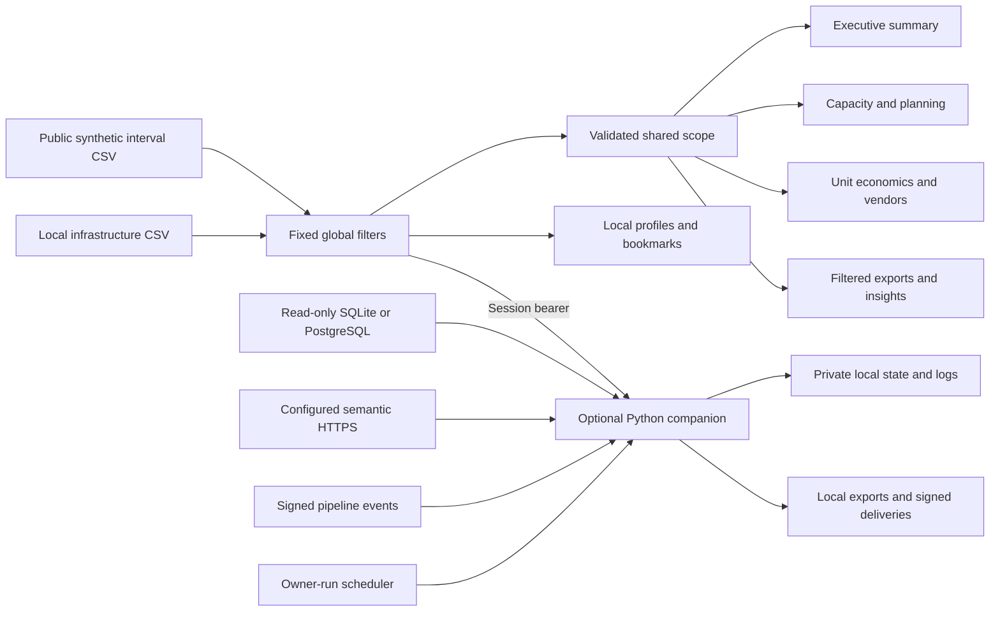

# Infrastructure BizOps architecture

The Hugging Face dashboard is static HTML, CSS and native ES modules. There is no paid service, runtime frontend dependency, telemetry or hidden server in the Space. The new infrastructure metric engine consumes normalized interval facts; a single validated global filter state supplies all three primary tabs and the active-scope exports.

`src/infra.js` owns interval validation, shared filtering, weighted aggregates, group and time-series summaries, simulations, anomalies, forecasts and source health. `src/infra-state.js` validates persistent browser state. `src/runner.js` preserves server schedules by merging a fresh read before a collection update. `src/app.js` and CSS own the UI. The previously tested retail library remains in the source package for compatibility regression tests; it is not the new dashboard's business model.

The fixed header is outside the three tab panels. Its measured height reserves document space so scroll content and focus targets do not disappear beneath it. Filter inputs retain their DOM and focus across tab navigation. Utility dialogs handle source/health, personalization, exports, sharing and runner operations without creating extra primary tabs.

The optional companion uses explicit `schema: "infrastructure-v1"` for the new fact contract and preserves old schema-default retail configurations. A source name maps to owner-reviewed configuration. Warehouse/semantic credentials and webhook secrets remain in local configuration/environment. Browser callers cannot submit arbitrary server SQL, filesystem paths or remote URLs.

Scheduling requires an owner-operated process; static hosting does not execute jobs while the dashboard is closed. Public backend exposure, authenticated tenant isolation and managed uptime remain separate launch requirements. See `infrastructure-contract.md`, `companion/README.md` and `launch-readiness.md`.
